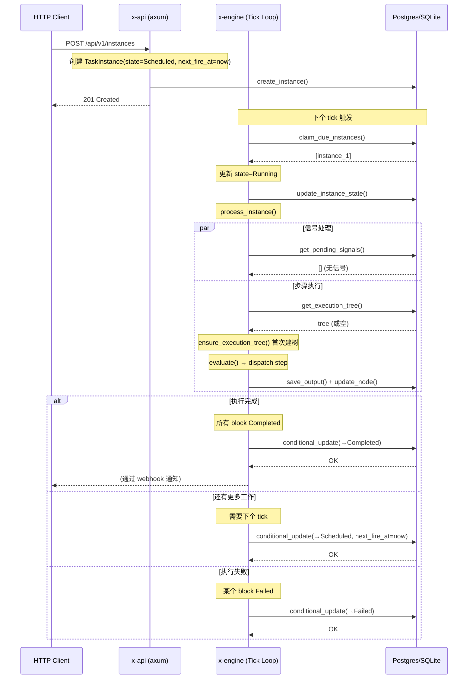
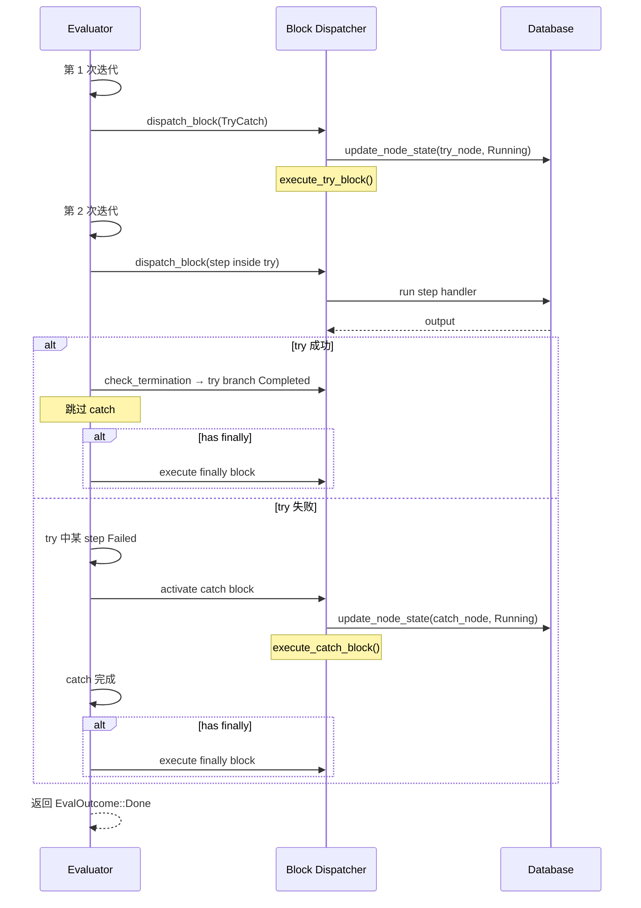
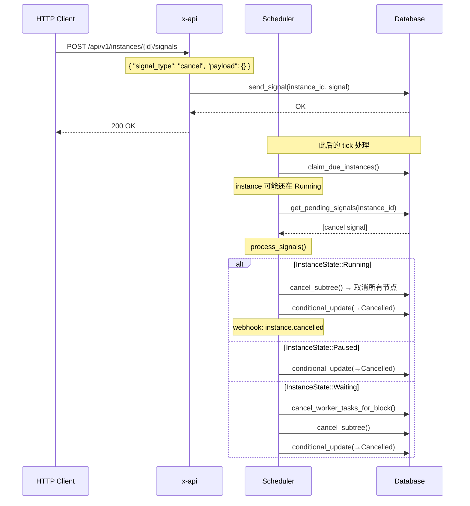
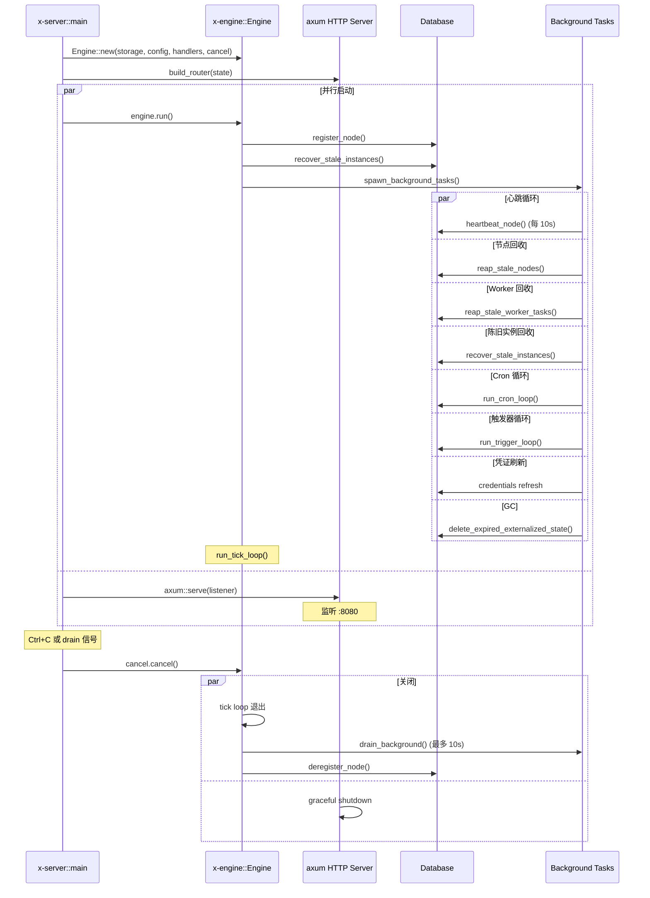
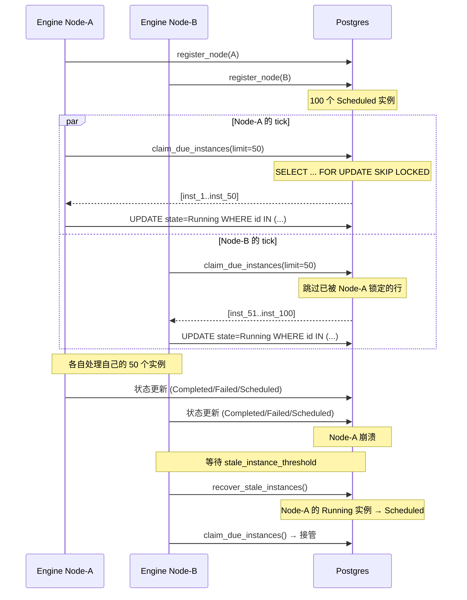

# x.engine — 架构文档

> **x.engine** 是一个高性能、通用流程编排引擎，专注于 **API 编排**场景。
> 基于 Rust 构建，使用 tokio 异步运行时，支持 Postgres / SQLite 双存储后端。

---

## 1. 总体架构

```
┌─────────────────────────────────────────────────────────────┐
│                     x-server (二进制入口)                     │
│  ┌──────────────────┐  ┌──────────────────────────────────┐ │
│  │   引擎循环         │  │   HTTP 服务器 (axum)              │ │
│  │   · Tick Loop     │  │   · 序列 CRUD  /api/v1/sequences  │ │
│  │   · 后台任务       │  │   · 实例管理  /api/v1/instances   │ │
│  │     (心跳/回收/    │  │   · 信号发送                      │ │
│  │      cron/触发/GC) │  │   · SSE 流式输出                  │ │
│  └────────┬──────────┘  └────────────────┬─────────────────┘ │
└───────────┼──────────────────────────────┼───────────────────┘
            │                              │
            ▼                              ▼
┌──────────────────────────────────────────────────────────────┐
│                        x-engine                               │
│  ┌──────────┐  ┌──────────┐  ┌────────────┐  ┌───────────┐ │
│  │ Scheduler│  │ Evaluator│  │ Expression │  │ Template  │ │
│  │ (TickLoop)│  │ (ExecTree)│  │ Engine     │  │ Engine    │ │
│  └──────────┘  └──────────┘  └────────────┘  └───────────┘ │
│  ┌──────────────────────────────────────────────────────────┐│
│  │  Handlers (30+ built-in step handlers)                  ││
│  │  http_request, sleep, llm_call, agent, emit_event, ...  ││
│  └──────────────────────────────────────────────────────────┘│
│  ┌──────┐ ┌──────┐ ┌────┐ ┌────────┐ ┌──────┐ ┌──────────┐│
│  │Signal│ │Cron  │ │GC  │ │Preload │ │Lifecy│ │Webhooks  ││
│  └──────┘ └──────┘ └────┘ └────────┘ └──────┘ └──────────┘│
└──────────────────────────┬───────────────────────────────────┘
                           │
                           ▼
┌──────────────────────────────────────────────────────────────┐
│                       x-storage                               │
│  ┌──────────────────────────────────────────────────────────┐│
│  │            StorageBackend trait (11 sub-traits)          ││
│  │  SequenceStore + InstanceStore + ExecutionTreeStore +    ││
│  │  OutputStore + SignalStore + WorkerStore + ...           ││
│  └──────────────────────────────────────────────────────────┘│
│  ┌────────────────────┐  ┌────────────────────────────────┐  │
│  │   PostgresStorage   │  │    SqliteStorage               │  │
│  │   (生产环境)         │  │    (开发/测试/嵌入式)           │  │
│  │   · FOR UPDATE      │  │    · WAL 模式                  │  │
│  │     SKIP LOCKED     │  │    · 内存/文件后端              │  │
│  │   · JSONB           │  │    · TEXT 存储                 │  │
│  └────────────────────┘  └────────────────────────────────┘  │
└──────────────────────────────────────────────────────────────┘
```

## 2. Crate 依赖关系

```
                         ┌──────────┐
                         │  x-types │  ← 领域类型、无运行时依赖
                         └────┬─────┘
                              │
                    ┌─────────┴─────────┐
                    │                   │
              ┌─────▼─────┐       ┌─────▼─────┐
              │ x-storage  │       │ x-engine   │
              │ (存储抽象)  │       │ (引擎核心)  │
              └─────┬─────┘       └─────┬─────┘
                    │                   │
                    └────────┬──────────┘
                             │
                       ┌─────▼─────┐
                       │   x-api   │  ← HTTP API 层
                       └─────┬─────┘
                             │
                       ┌─────▼─────┐
                       │  x-server │  ← 二进制入口
                       └───────────┘
```

| Crate | 依赖 | 说明 |
|---|---|---|
| `x-types` | 无 workspace 依赖 | 纯数据类型，包含 `config`, `sequence`, `instance`, `execution`, `signal`, `context`, `ids` 等 |
| `x-storage` | `x-types` | `StorageBackend` trait + Postgres / SQLite 实现 |
| `x-engine` | `x-types`, `x-storage` | 调度器、评估器、Handler 注册、表达式/模板引擎 |
| `x-api` | `x-types`, `x-storage`, `x-engine` | HTTP API handler（axum） |
| `x-server` | 全部 | 组合引擎 + API + 启动 |

---

## 3. 核心数据模型

### 3.1 状态机 — InstanceState

```
                  ┌─────────────────────────────────────┐
                  │              Scheduled               │
                  │           (等待被调度)                │
                  └──────────┬──────────────────────────┘
                             │ claim_due_instances
                             ▼
                  ┌─────────────────────────────────────┐
           ┌─────│               Running                │─────┐
           │     │           (正在执行中)                 │     │
           │     └──────────┬──────────────────────────┘     │
           │                │                                │
           │    ┌───────────┼───────────┐                    │
           ▼    ▼           ▼           ▼                    ▼
     ┌────────┐ ┌────────┐ ┌────────┐ ┌────────┐     ┌──────────┐
     │Waiting │ │ Paused │ │Scheduled│ │Completed│    │ Cancelled│
     │(外部分发)│ │(暂停)   │ │(重试)   │ │(完成)   │    │ (取消)   │
     └───┬────┘ └───┬────┘ └────────┘ └────────┘     └──────────┘
         │          │
         │  resume  │  pause
         ▼          │
     ┌────────┐     │
     │Running │◄────┘
     └────────┘
```

**合法转移规则**（`InstanceState::can_transition_to`）：

| from → to | 说明 |
|---|---|
| `Scheduled → Running` | 正常调度 |
| `Scheduled → Paused` | 创建时即暂停 |
| `Scheduled → Cancelled` | 创建后取消 |
| `Running → Scheduled` | 需要更多 tick 处理 |
| `Running → Waiting` | 等待外部 Worker |
| `Running → Completed` | 正常完成 |
| `Running → Failed` | 执行失败 |
| `Running → Paused` | 暂停 |
| `Running → Cancelled` | 取消 |
| `Waiting → Running` | Worker 回调后继续 |
| `Waiting → Scheduled` | 重新调度 |
| `Waiting → Cancelled` | 取消 |
| `Waiting → Failed` | Worker 报告失败 |
| `Paused → Scheduled` | 恢复执行 |
| `Paused → Cancelled` | 取消 |
| `Failed → Scheduled` | 从 DLQ 重试 |

### 3.2 执行树节点状态 — NodeState

```
Pending → Running → Completed
               ↘  Waiting → (外部 Worker 完成后) → Pending/Completed
               ↘  Failed
               ↘  Cancelled
          Skipped (被路由跳过)
```

### 3.3 序列定义 — Sequence + BlockDefinition

```
SequenceDefinition
├── id: SequenceId
├── tenant_id, namespace, name, version
├── status: Draft / Staging / Production / Unpublished
├── blocks: Vec<BlockDefinition>     ← 递归的 block 树
└── interceptors: Option<InterceptorDef>

BlockDefinition (递归枚举)
├── Step(StepDef)                    ← 叶子节点，含 handler + params
├── Parallel(ParallelDef)            ← 并行执行所有分支
├── Race(RaceDef)                    ← 竞速：最快分支获胜
├── Loop(LoopDef)                    ← 条件循环
├── ForEach(ForEachDef)              ← 遍历集合动态展开
├── Router(RouterDef)                ← 条件路由
├── TryCatch(TryCatchDef)            ← 异常捕获 + finally
├── SubSequence(SubSequenceDef)      ← 嵌套调用子工作流
├── ABSplit(ABSplitDef)              ← A/B 测试切割
└── CancellationScope(CSDef)         ← 防取消保护域
```

### 3.4 执行上下文 — ExecutionContext

```
ExecutionContext
├── data: Value        ← 读写：step handler 可读可写
├── config: Value      ← 只读：创建实例时设置
├── audit: Vec<Entry>  ← 追加：自动记录审计事件
└── runtime: Runtime   ← 只读：引擎管理（attempt, started_at 等）
```

### 3.5 信号系统 — Signal

```
Signal
├── id, instance_id
├── signal_type: SignalType
│   ├── Pause          ← 暂停实例
│   ├── Resume         ← 恢复实例
│   ├── Cancel         ← 取消实例
│   ├── UpdateContext  ← 更新上下文数据
│   └── Custom(name)   ← 自定义信号
└── payload: Value
```

---

## 4. 引擎架构：Tick Loop

这是引擎最核心的循环，在 `x-engine/src/scheduler.rs` 中实现。

### 4.1 主循环流程

```
┌─────────────────────────────────────────────────────────────────────┐
│  run_tick_loop()                                                     │
│  ─────────────                                                        │
│  loop {                                                                │
│     1. ticker.tick().await  ← 等待 tick 间隔（可配置）                 │
│     2. process_tick()        ← 核心处理                                │
│     3. process_signalled_instances()  ← 处理暂停/等待实例的信号        │
│     4. process_waiting_deadlines()    ← 检查外部 Worker 超时          │
│  }                                                                    │
└─────────────────────────────────────────────────────────────────────┘
```

### 4.2 process_tick() 详细流程

```
process_tick(ctx)
│
├─ 1. Semaphore.available_permits() → 计算可用并发槽位
│
├─ 2. storage.claim_due_instances(now, limit, max_per_tenant)
│      ↓
│     SELECT ... FROM task_instances
│     WHERE state = 'scheduled' AND next_fire_at <= now
│     ORDER BY priority DESC, next_fire_at ASC
│     LIMIT $1
│     FOR UPDATE SKIP LOCKED         ← 多节点安全竞争
│
├─ 3. enforce_concurrency_limits()  ← 超限实例放回 Scheduled
│
├─ 4. Batch pre-fetch (2 并发查询)
│   ├─ get_pending_signals_batch()   ← 所有实例的待处理信号
│   └─ get_completed_block_ids_batch() ← 已完成的 block
│
├─ 5. preload_externalized_markers() ← 批量回填外部化字段
│
├─ 6. for each instance (并发上限 = Semaphore):
│      tokio::spawn(async {
│          process_instance() 或 process_instance_tree()
│          // 执行完成后释放 Semaphore permit
│      })
│
└─ 7. 返回（不 await 任务 — fire-and-forget）
```

### 4.3 process_instance() 处理单个实例

```
process_instance(storage, handlers, instance, sequence)
│
├─ 1. 检查 max_steps_per_instance (超过则 fail)
│
├─ 2. 处理信号
│   ├─ Pause   → 状态转 Paused，返回
│   ├─ Cancel  → 状态转 Cancelled，返回
│   ├─ Resume  → 如果是 Paused 状态则转 Scheduled
│   └─ UpdateContext → 合并 payload 到 context
│
├─ 3. 检查输出是否就绪（依赖的 block 已完成？）
│
├─ 4. 执行 step 或进入树评估器
│
├─ 5. 后处理
│   ├─ 所有 block 完成 → 转 Completed
│   ├─ 有失败的 block → 转 Failed
│   └─ 有更多工作 → 转 Scheduled (下个 tick) 或 Waiting (外部 worker)
│
└─ 6. 触发 webhook + metrics + 清理
```

### 4.4 后台任务（Engine::spawn_background_tasks）

| 任务 | 间隔 | 说明 |
|---|---|---|
| 节点心跳 | 10s | 更新集群节点最后心跳时间 |
| Drain 检查 | 10s | 检测是否有 drain 信号触发关闭 |
| 陈旧节点回收 | 可配置 | 清理超时的集群节点 |
| Worker 任务回收 | 可配置 | 重置超时的 WorkerTask |
| 陈旧实例回收 | threshold/2 | 恢复卡住的实例 |
| Cron 循环 | 可配置 | 触发定时调度 |
| 触发器循环 | 15s | 同步触发器定义 |
| 凭证刷新 | 60s | 刷新 OAuth2 令牌 |
| GC 清理 | 5min | 清理过期 externalized_state |

---

## 5. 执行树评估器 (Evaluator)

在 `x-engine/src/evaluator.rs` 中实现，是复合 block 的执行引擎。

### 5.1 评估循环

```
evaluate(storage, handlers, instance, sequence)
│
├─ 1. merged_blocks() → 合并注入的 block
├─ 2. flatten_blocks() → 构建 block_id → BlockDefinition 的 HashMap
├─ 3. ensure_execution_tree() → 从 sequence 构建执行树（首次）或复用
├─ 4. 进入迭代循环（最多 200 次）
│
│   for _ in 0..200 {
│   ├─ 刷新 instance 和 tree（如果标记为 stale）
│   ├─ SLA deadline 检查
│   ├─ check_termination() → 检查根节点是否全部完成
│   ├─ dispatch_block() → 查找下一个可执行的节点
│   │   ├─ Step          → step_block::execute_step_node()
│   │   ├─ Parallel      → 激活所有子节点
│   │   ├─ Race          → 激活所有子节点，最先完成者胜
│   │   ├─ Loop          → 检查条件 → 继续或退出
│   │   ├─ ForEach       → 展开集合 → 为每个元素创建子节点
│   │   ├─ Router        → 评估条件 → 执行匹配路由
│   │   ├─ TryCatch      → 执行 try → 失败时执行 catch → finally
│   │   ├─ SubSequence   → 创建子实例
│   │   ├─ ABSplit       → 按权重选执行分支
│   │   └─ CancellationScope → 执行子块（防取消）
│   └─ }
│
└─ 5. 返回 EvalOutcome
    ├─ Done { any_failed, any_cancelled }
    └─ MoreWork { has_waiting_nodes }
```

### 5.2 复合 Block 的执行策略

| Block 类型 | 子节点激活策略 | 完成条件 |
|---|---|---|
| **Parallel** | `activate_pending_children` — 全部激活 | 所有分支 terminal |
| **Race** | `activate_pending_children` — 全部激活 | 任意分支 Completed |
| **Loop** | `activate_first_pending_child` — 顺序 | 条件为 false 或超迭代限制 |
| **ForEach** | 动态构建子节点 | 所有迭代 terminal |
| **Router** | `activate_first_pending_child` — 顺序 | 匹配路由完成/默认完成 |
| **TryCatch** | 顺序：try → catch(如有失败) → finally | finally 完成 |
| **CancellationScope** | `activate_first_pending_child` — 顺序 | 所有子节点 terminal |

---

## 6. Handler 系统

### 6.1 注册机制

```rust
// HandlerRegistry 是 Handler 的注册中心
pub struct HandlerRegistry { /* HashMap<String, StepHandler> */ }

// StepHandler 签名
pub type StepHandler = Box<
    dyn Fn(StepContext) -> Pin<Box<dyn Future<Output = Result<Value, StepError>> + Send>>
        + Send + Sync
>;
```

### 6.2 内置 Handler（25+）

| Handler | 说明 | 文件 |
|---|---|---|
| `noop` | 空操作 | `builtin.rs` |
| `log` | 日志输出 | `builtin.rs` |
| `sleep` | 延迟等待 | `builtin.rs` |
| `fail` | 主动失败 | `builtin.rs` |
| `http_request` | HTTP 请求 | `builtin.rs` |
| `llm_call` | LLM 调用（OpenAI/Anthropic） | `llm/` |
| `tool_call` | 工具调用 | `tool_call.rs` |
| `mcp_call` | MCP 协议调用 | `mcp.rs` |
| `agent` | AI Agent 循环 | `agent.rs` |
| `embed` | 向量嵌入 | `llm/` |
| `memory_store/search` | 记忆存储/搜索 | `memory.rs` |
| `human_review` | 人工审批 | `human_review.rs` |
| `self_modify` | 自修改序列定义 | `self_modify.rs` |
| `emit_event` | 发出事件（创建子实例） | `emit_event.rs` |
| `send_signal` | 发送信号 | `send_signal.rs` |
| `query_instance` | 查询实例状态 | `query_instance.rs` |
| `set/get/delete/merge_state` | KV 状态操作 | `builtin.rs` |
| `transform` | 数据变换 | `builtin.rs` |
| `assert` | 断言验证 | `builtin.rs` |
| `blob_put/get` | 二进制大对象 | `blob.rs` |
| WASM 插件 | WebAssembly 扩展 | `wasm_plugin.rs` |
| Activepieces | Activepieces 集成 | `activepieces.rs` |

### 6.3 参数解析流程

```
params (含 {{ 模板 }})
   │
   ▼
template::resolve() ← 读取 context.data, context.config, outputs.*, state.*
   │
   ▼
resolve_templates_in_params()
   │
   ▼
context_for_step() ← 根据 ContextAccess 过滤上下文
   │
   ▼
StepContext → StepHandler → 执行
```

---

## 7. 表达式与模板引擎

### 7.1 表达式引擎（`expression.rs`）

用于条件判断（Router、Loop、条件执行）。

```
表达式: "outputs.step_1.status == 200 && context.data.role in [\"admin\"]"
               ↓
          tokenize() → [Identifier, Dot, Identifier, Eq, Number, ...]
               ↓
          evaluate() → serde_json::Value::Bool(true)
```

支持的语法：
- **路径**: `context.data.x`, `context.config.x`, `context.runtime.x`, `outputs.block_id`, `steps.block_id`, `state.key`
- **运算符**: `==`, `!=`, `>`, `>=`, `<`, `<=`, `&&`, `||`, `!`, `in`
- **三元**: `cond ? a : b`
- **数学**: `+`, `-`, `*`, `/`
- **字面量**: 字符串、数值、布尔、null

Token 缓存：`moka::sync::Cache<String, Arc<[Token]>>`（10K 条目，TTL 10 分钟）

### 7.2 模板引擎（`template.rs`）

用于 Step 参数的 JSON 值替换。

```
参数: { "url": "https://api.example.com/users/{{context.data.user_id}}" }
                    ↓
          resolve() → { "url": "https://api.example.com/users/42" }
```

支持的路径和过滤器：

- `{{context.data.key}}` / `{{context.config.key}}` / `{{context.runtime.key}}`
- `{{outputs.block_id.field}}` / `{{steps.block_id.field}}`
- `{{state.key}}` — KV 状态
- `{{value | upper}}` / `{{value | lower}}` / `{{value | trim}}` / ...

---

## 8. 存储层

### 8.1 StorageBackend trait（11 个子 trait）

```
StorageBackend (super-trait)
├── SequenceStore       — 序列 CRUD + 版本管理
├── InstanceStore       — 实例 CRUD + 状态转移 + 并发标记
├── ExecutionTreeStore  — 执行树节点管理
├── OutputStore         — Block 输出存储
├── SignalStore         — 信号发送/接收/确认
├── WorkerStore         — WorkerTask 创建/领取/完成/心跳
├── SchedulingStore     — 调度辅助（延迟、发送窗口）
├── AdminStore          — 审计日志、KV 状态
├── TelemetryStore      — 遥测事件
└── ResourceStore       — 资源池管理
```

### 8.2 Postgres 数据库表

| 迁移文件 | 表 | 说明 |
|---|---|---|
| `001` | `sequences` | 序列定义（JSONB 存储 blocks） |
| `002` | `task_instances` | 实例（JSONB context） |
| `003` | `execution_tree` | 执行树节点 |
| `004` | `block_outputs` | Block 输出（JSONB） |
| `005` | `rate_limits` | 速率限制 |
| `006` | `resource_pools` | 资源池 |
| `007` | `signal_inbox` | 信号队列 |
| `008` | `externalized_state` | 大字段外部化存储 |
| `011` | `cron_schedules` | 定时调度 |
| `012` | `worker_tasks` | 外部 Worker 任务 |
| `015` | `checkpoints` | 检查点 |
| `016` | `audit_log` | 审计日志 |
| `019` | `cluster_nodes` | 集群节点注册 |
| `033` | `instance_kv_state` | KV 状态 |

### 8.3 Postgres 的关键 SQL 特性

```sql
-- 原子性 claim（多节点竞争）
SELECT * FROM task_instances
WHERE state = 'scheduled' AND next_fire_at <= NOW()
ORDER BY priority DESC, next_fire_at ASC
LIMIT $1
FOR UPDATE SKIP LOCKED;

-- CAS 状态更新（防并发覆盖）
UPDATE task_instances
SET state = $2, next_fire_at = $3, updated_at = NOW()
WHERE id = $1 AND state = $4;
```

---

## 9. 外部化机制 (Externalization)

当 context.data 的某个 top-level 字段超过阈值时，自动将其移到 `externalized_state` 表。

### 9.1 写路径

```
context.data = { "ocr_result": { full OCR JSON (5MB) } }
                      │
                      ▼ threshold > 1024?
                      │
                ┌─────┴─────┐
                ▼            ▼
              YES            NO
              │
              ▼
externalized_state:
  ref_key: "inst1:ctx:data:ocr_result"
  payload: { full OCR JSON }

context.data.ocr_result → {
  "_externalized": true,
  "_ref": "inst1:ctx:data:ocr_result"
}
```

### 9.2 读路径

每个 tick 开始时，`preload_externalized_markers()` 用**一次批查询**回填所有 marker：

```
1. 扫描所有 claimed instance 的 context.data 顶层字段
2. 收集 marker 中的 ref_key → Vec<String>
3. batch_get_externalized_state(ref_keys) → HashMap<String, Value>
4. 遍历 instance，将 marker 替换为真实值
```

### 9.3 配置

```rust
SchedulerConfig {
    externalize_output_threshold: 0,    // 0 = 禁用，>0 启用
    max_context_bytes: 256 * 1024,      // 硬上限，0 = 不检查
}
```

---

## 10. 时序图

### 10.1 实例生命周期



### 10.2 复合 Block 执行（TryCatch 示例）



### 10.3 信号处理流程



### 10.4 引擎启动与优雅关闭



### 10.5 多节点横向扩展



---

## 11. 模块依赖图（引擎内部）

```
x-engine/src/
│
├── lib.rs                          ← Engine 结构体 + run()
├── scheduler.rs                    ← Tick Loop 入口
│   ├── run_tick_loop()              ← 主循环
│   ├── process_tick()               ← 单 tick 处理
│   ├── process_instance()           ← 快速路径 (线性 block)
│   ├── process_instance_tree()      ← 树路径 (复合 block)
│   └── process_signalled_instances() ← 信号处理
│
├── scheduler/
│   ├── step_exec.rs                ← step 执行逻辑
│   └── tests.rs                    ← 调度器测试
│
├── evaluator.rs                    ← 执行树评估器
│   ├── evaluate()                   ← 主评估逻辑
│   ├── merged_blocks()              ← 合并注入 blocks
│   ├── ensure_execution_tree()      ← 构建执行树
│   ├── check_termination()          ← 终止条件检查
│   ├── flatten_blocks()             ← 扁平化 block 索引
│   └── children_of() / cancel_subtree() / ...
│
├── evaluator/
│   ├── dispatch.rs                 ← dispatch_block() 派发中心
│   ├── sla.rs                      ← SLA deadline 检查
│   └── tests.rs                    ← 评估器测试
│
├── handlers/
│   ├── mod.rs                      ← HandlerRegistry + StepContext
│   ├── step.rs                     ← step 执行 (参数解析 + 外部化)
│   ├── step_block.rs               ← Step block 处理器
│   ├── step_dispatch.rs            ← handler 分发 + WorkerTask 创建
│   ├── param_resolve.rs            ← 参数模板解析 (OutputsSnapshot)
│   │
│   ├── parallel.rs                 ← Parallel block
│   ├── race.rs                     ← Race block
│   ├── loop_block.rs               ← Loop block
│   ├── for_each.rs                 ← ForEach block
│   ├── router.rs                   ← Router block
│   ├── try_catch.rs                ← TryCatch block
│   ├── ab_split.rs                 ← ABSplit block
│   ├── cancellation_scope.rs       ← CancellationScope block
│   ├── sub_sequence.rs             ← SubSequence block
│   │
│   ├── builtin.rs                  ← 内置 handler (http, sleep, set_state...)
│   ├── llm/                        ← LLM handler (OpenAI/Anthropic)
│   ├── agent.rs                    ← AI Agent handler
│   ├── mcp.rs                      ← MCP handler
│   ├── tool_call.rs                ← Tool call handler
│   ├── human_review.rs             ← 人工审批 handler
│   ├── memory.rs                   ← 记忆存储/搜索 handler
│   ├── emit_event.rs               ← 事件发射 handler
│   ├── send_signal.rs              ← 信号发送 handler
│   ├── query_instance.rs           ← 实例查询 handler
│   ├── self_modify.rs              ← 自修改 handler
│   ├── blob.rs                     ← 大对象 handler
│   ├── wasm_plugin.rs              ← WASM 插件 handler
│   └── grpc_plugin.rs              ← gRPC 插件 handler
│
├── expression.rs                   ← 表达式引擎
├── template.rs                     ← 模板引擎
├── signals.rs                      ← 信号处理逻辑
├── lifecycle.rs                    ← 状态转移 + 审计
├── webhooks.rs                     ← Webhook 发送
├── interceptors.rs                 ← 生命周期拦截器
├── sequence_cache.rs               ← 序列定义 LRU 缓存
├── preload.rs                      ← 批量回填外部化数据
├── externalized.rs                 ← 外部化标记工具函数
├── cron.rs                         ← Cron 调度
├── triggers.rs                     ← 触发器处理
├── credentials.rs                  ← OAuth2 凭证刷新
├── gc.rs                           ← 外部化数据 GC
├── recovery.rs                     ← 启动时实例恢复
├── circuit_breaker.rs              ← 熔断器
├── lint.rs                         ← 序列校验
├── required_fields.rs              ← 必填字段检查
├── metrics.rs                      ← Prometheus 指标
├── error.rs                        ← 引擎错误类型
│
├── scheduling/
│   ├── delay.rs                    ← 延迟执行
│   ├── send_window.rs              ← 发送窗口
│   └── pool.rs                     ← 资源池调度
│
└── tests/common/mod.rs             ← 测试辅助
```

---

## 12. 关键设计决策

| 决策 | 选择 | 原因 |
|---|---|---|
| **并发模型** | tokio async + spawn per instance | 利用 Rust async 实现高并发，慢 handler 不阻塞 tick loop |
| **并发控制** | Semaphore + concurrency_key | 双重保障：全局并发上限 + 按 key 的并行限制 |
| **多节点竞争** | `FOR UPDATE SKIP LOCKED` | 数据库原生支持，无需外部协调服务 |
| **大字段处理** | Externalization（JSONB → 独立表） | 保持主表查询性能，避免大字段拖慢 tick |
| **引擎-API 关系** | 同一进程（库模式） | 减少网络开销，简化部署 |
| **状态转移** | CAS（条件更新） | 防止并发覆盖，保证状态机一致性 |
| **Block DSL** | 递归 enum（JSON) | 灵活、可扩展、序列化友好 |
| **Step Handler** | 注册模式（Fn trait） | 零活动仪式，容易扩展 |
| **表达式缓存** | moka LRU Cache | 避免重复 tokenize 热点路径表达式 |
| **序列缓存** | moka LRU Cache | 减少 tick loop 中的 DB 查询 |
| **持久化** | JSONB（Postgres） | 利用 PG 的 JSON 索引能力 |

---

## 13. 数据流全景图

```
创建实例
─────────
HTTP POST /api/v1/instances
  → x-api::create_instance()
    → storage.create_instance(state=Scheduled, next_fire_at=now)
    → 返回 201

调度执行
─────────
Tick Loop (每 tick_interval_ms)
  → claim_due_instances()  [FOR UPDATE SKIP LOCKED]
  → 并发处理每个实例:
      process_instance() / process_instance_tree()
        → 1. process_signals()  [pause/resume/cancel/update_context]
        → 2. evaluate() [执行树评估]
            → dispatch_block() [按 block type 分发]
              → Step:   execute_step_node()
                → resolve_templates_in_params()
                → context_for_step() [按访问权限过滤]
                → handler_fn().await [执行 handler]
                → maybe_externalize() [大输出自动外部化]
                → save_output() + complete_node()
              → Parallel:  activate_pending_children()
              → Race:      activate_pending_children() + 首完成者胜
              → Loop:     check_condition() → 继续或退出
              → ForEach:  expand_collection() → 创建子节点
              → Router:   evaluate_conditions() → 匹配路由
              → TryCatch: execute_try() → 失败后 catch → finally
        → 3. transition_instance() [状态转移]
            → Completed / Failed / Cancelled
            → Scheduled (more work) / Waiting (external worker)
        → 4. webhooks + metrics + 拦截器

信号处理
─────────
HTTP POST /api/v1/instances/{id}/signals
  → storage.send_signal() [写入 signal_inbox]
  → 下个 tick 的 process_signals() 处理

外部 Worker (框架预留，待实现)
────────────────────────
WorkerTask 创建于 step_dispatch.rs
  → storage.create_worker_task()
  → 节点状态 → Waiting
  → (需要消费者: HTTP API / gRPC / MQ)
```

---

## 14. 配置参考

```rust
SchedulerConfig {
    tick_interval_ms: 100,              // tick 间隔 (ms)
    batch_size: 100,                    // 每 tick 最多 claim 实例数
    max_concurrent_steps: 1000,         // 最大并发 step 数
    shutdown_grace_period_secs: 30,     // 优雅关闭等待时间
    stale_instance_threshold_secs: 300, // 实例超时阈值 (恢复用)
    max_context_bytes: 262144,          // context 硬上限 (256 KiB)
    externalize_output_threshold: 0,    // 外部化阈值 (0=禁用)
    max_instances_per_tenant: 0,        // 每租户最大实例 (0=不限)
    max_steps_per_instance: 0,          // 每实例最大 step (0=不限)
    cron_tick_secs: 60,                 // Cron 检查间隔
    node_reaper_tick_secs: 30,          // 节点回收检查间隔
    node_reaper_stale_secs: 90,         // 节点超时阈值
    worker_reaper_tick_secs: 30,        // Worker 回收检查间隔
    worker_reaper_stale_secs: 120,      // Worker 超时阈值
    artifact_retention_secs: 0,         // 制品保留时间 (0=永久)
}
```

---

> 文档版本: v1.0 · 最后更新: 2025-07-16
